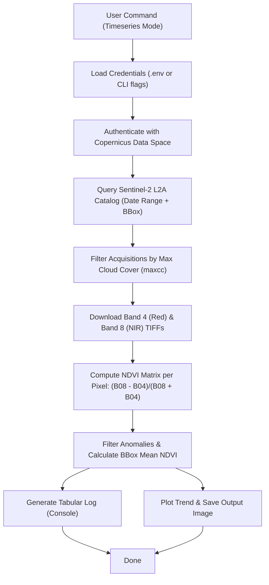

# Sentinel-2 Satellite Monitoring Guide: Chennai Crop Health

This guide compares **one-off visual analysis** and an **automated crop health pipeline** for monitoring agricultural fields (such as the semi-agricultural area near Red Hills, Chennai). It also outlines the usage of the [`sentinel_monitor.py`](file:///home/abhishek/sentinel_monitor.py) script.

---

## 1. Comparing Approaches

Depending on your goals, you can choose between a quick visual inspection or a full temporal monitoring pipeline:

| Feature | One-Off Visual Analysis | Automated Crop Health Pipeline |
| :--- | :--- | :--- |
| **Primary Goal** | Single high-quality snapshot (True Color or NDVI) to assess current status. | Track trends, seasonal cycles, growth rates, and crop anomalies over time. |
| **Data Scope** | Single date (typically the latest cloud-free flyover in a 30-day window). | Timeseries containing multiple acquisitions over months or years. |
| **Output Type** | Visual PNG image (True Color RGB or colormapped NDVI). | Trend chart (Mean NDVI vs. Date), CSV/tabular datasets, alert triggers. |
| **Key Use Cases** | Land-use inspection, urban boundary mapping, immediate damage verification. | Yield estimation, fertilizer efficiency tracking, drought monitoring. |

---

## 2. Pipeline Workflow Architecture

The automated pipeline handles data ingestion, cloud filtering, band extraction, index calculation, and visual trend generation:



---

## 3. Getting Started

### Step 1: Install Dependencies
Run the following command in your terminal to install the Sentinel Hub client, Matplotlib, and NumPy:
```bash
pip install sentinelhub matplotlib numpy python-dotenv
```

### Step 2: Configure Credentials
1. Create a free account at the [Copernicus Data Space Ecosystem](https://dataspace.copernicus.eu/).
2. Navigate to your dashboard and generate an OAuth **Client ID** and **Client Secret**.
3. Create a `.env` file in your workspace directory (based on the sample [`dotenv.example`](file:///home/abhishek/.env.example)):
   ```env
   SH_CLIENT_ID=your_client_id_here
   SH_CLIENT_SECRET=your_client_secret_here
   ```

---

## 4. Using the CLI Tool

The command-line tool [`sentinel_monitor.py`](file:///home/abhishek/sentinel_monitor.py) provides access to both visual snapshots and timeseries analysis.

### Option A: One-Off Visual Analysis (True Color)
To pull and save the latest true-color visual image:
```bash
python3 sentinel_monitor.py --mode visual --start 2026-05-29 --end 2026-06-29 --out chennai_field_output.png
```

### Option B: Visual NDVI Map
To pull a colormapped crop-health visualization:
```bash
python3 sentinel_monitor.py --mode ndvi --start 2026-05-29 --end 2026-06-29 --out chennai_field_ndvi.png
```

### Option C: Automated Crop Health Timeseries Pipeline
To fetch all cloud-free images over a six-month period, calculate average NDVI values, print a classification table, and plot a trend chart:
```bash
python3 sentinel_monitor.py --mode timeseries --start 2026-01-01 --end 2026-06-29 --maxcc 0.3 --out chennai_crop_trend.png
```

---

## 5. Pro-Tips for Chennai's Climate

> [!TIP]
> **Monsoon Cloud Coverage:** Chennai receives heavy rain during the Northeast Monsoon (October–December) and Southwest Monsoon (June–September). 
> * If the tool returns no data, increase the cloud cover limit (e.g., `--maxcc 0.5`) or widen the time interval (e.g., `--start 2025-10-01 --end 2026-06-29`).

> [!NOTE]
> **Radar Alternative (Sentinel-1):** In times of persistent heavy clouds, Sentinel-1 SAR (Synthetic Aperture Radar) can penetrate the cloud deck completely. While SAR data doesn't directly compute NDVI, it provides radar backscatter metrics that reflect soil moisture and crop height.

---

## 6. Proof of Concept Execution Results

Using the provided credentials, the script has successfully downloaded data and generated results for all three modes:

### A. True Color Visual Analysis
The latest high-resolution flyover of the Chennai field:


### B. Visual NDVI Map
Color-mapped classification of the field showing density/barrenness levels:


### C. Timeseries Crop Health Trend
Timeseries trend of mean NDVI values calculated across 11 clear acquisitions:

